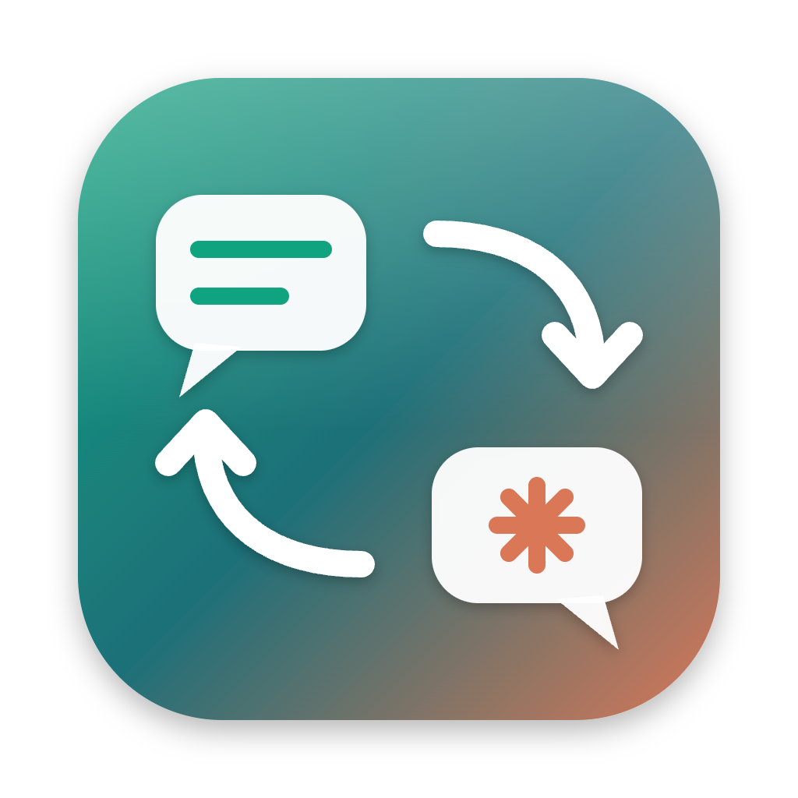

<p align="center">
  
</p>

<h1 align="center">Integra Claude</h1>

<p align="center"><strong>Pare de copiar e colar entre o ChatGPT e o Claude Code.</strong></p>

<p align="center">
  
  
  
</p>

Você conversa com o ChatGPT (inclusive por voz) para pensar ideias e preparar prompts, e usa o
Claude Code no terminal para programar. O Integra Claude leva a última resposta de um para o
outro **com um clique**, nos dois sentidos, e ainda envia arquivos do seu projeto (constituição,
especificações, planos) para o ChatGPT.

```
┌──────────────┐        ┌──────────────────────────┐        ┌────────────────┐
│   ChatGPT    │  ───▶  │  ChatGPT → Claude        │  ───▶  │  Claude Code   │
│ (no Chrome)  │  ◀───  │  Claude → ChatGPT        │  ◀───  │ (no VS Code)   │
└──────────────┘        └──────────────────────────┘        └────────────────┘
                              app Integra Claude
```

> ⚠️ **Prova de conceito (POC).** Funciona e foi testado de verdade, mas depende de partes
> internas do ChatGPT e do Claude Code que podem mudar sem aviso. Use por sua conta e risco.

---

## Para quem é

- Quem usa o **ChatGPT no Google Chrome** (no navegador, não no app desktop do ChatGPT).
- Quem roda o **Claude Code no terminal integrado do VS Code**.
- Quem usa **Mac** (macOS 13 ou mais novo).

## O que ele faz

- Mostra suas **conversas do ChatGPT** à esquerda e suas **sessões do Claude Code** à direita.
- Você escolhe uma de cada lado, confere a **prévia** e clica na seta.
- A resposta chega como **uma mensagem sua**, na conversa ou sessão que **já existe**: ele não cria nada novo.
- Envia **arquivos do projeto** (ex.: `spec.md`) ao ChatGPT como anexo real, sempre na versão salva no disco.
- **Nunca envia nada sozinho**: só quando você clica.
- Mostra **"Enviado ✓" só quando confirma** que a mensagem chegou.

## O que você precisa

| Item | Como conferir |
|---|---|
| Mac com macOS 13+ | Menu  → Sobre este Mac |
| [Node.js](https://nodejs.org) 20 ou mais novo | No Terminal: `node -v` |
| Google Chrome com o ChatGPT logado | Abra chatgpt.com e veja se está logado |
| [VS Code](https://code.visualstudio.com) com o comando `code` | No Terminal: `code --version` (se não existir: no VS Code, `Cmd+Shift+P` → "Shell Command: Install 'code' command in PATH") |
| [Claude Code](https://docs.claude.com/claude-code) | No Terminal: `claude --version` |

---

## Instalação passo a passo (uns 10 minutos, uma vez só)

### Passo 1: Baixar o projeto

Abra o **Terminal** e rode:

```bash
cd ~/Desktop
git clone https://github.com/OtavioPortela/integra-claude.git
cd integra-claude/app
npm install
npm run build
```

### Passo 2: Instalar a extensão do Chrome

1. No Chrome, abra o endereço `chrome://extensions`.
2. Ligue o **Modo do desenvolvedor** (chave no canto superior direito).
3. Clique em **Carregar sem compactação** (*Load unpacked*).
4. Escolha a pasta `~/Desktop/integra-claude/extensions/chrome`.
5. Deve aparecer o card **Integra Claude 0.1.1**.

> Dica: clique no ícone de quebra-cabeça 🧩 da barra do Chrome e fixe a Integra Claude.

### Passo 3: Instalar a extensão do VS Code

No Terminal:

```bash
code --install-extension ~/Desktop/integra-claude/extensions/vscode/integra-claude-vscode.vsix
```

Depois, no VS Code, aperte `Cmd+Shift+P`, digite **Reload Window** e aperte Enter.

### Passo 4: Abrir o app

```bash
cd ~/Desktop/integra-claude/app
npx electron .
```

A janela **Integra Claude** abre.

### Passo 5: Parear o Chrome com o app

1. No app, clique em **Copiar código de pareamento** (canto superior direito).
2. No Chrome, clique na extensão **Integra Claude**.
3. Cole o código e clique em **Parear**.
4. O status muda para **conectado** e, no app, a pílula **ChatGPT (Chrome)** fica verde.

Pronto! Você só faz isso uma vez.

---

## Como usar no dia a dia

1. Abra o **Claude Code no terminal do VS Code**, como você já faz.
2. Abra o app: `cd ~/Desktop/integra-claude/app && npx electron .`
3. Escolha a **conversa do ChatGPT** (esquerda) e a **sessão do Claude** (direita).
4. Confira a **prévia** no centro.
5. Clique em:
   - **ChatGPT → Claude**: manda a última resposta do ChatGPT para o Claude.
   - **Claude → ChatGPT**: manda a última resposta do Claude para o ChatGPT.

### Pelo próprio Claude Code (sem abrir o app)

O projeto traz o comando de terminal `integra` e uma *skill* para o Claude Code. Com elas, você
pede em qualquer sessão: **"envia isso pro GPT"**. O Claude lista as suas conversas, pergunta
qual é e envia. Também funciona **"o que o GPT respondeu?"**.

Instalação (uma vez):

```bash
ln -sf ~/Desktop/integra-claude/cli/integra.mjs ~/.local/bin/integra
mkdir -p ~/.claude/skills/integra-claude
cp ~/Desktop/integra-claude/cli/skill/SKILL.md ~/.claude/skills/integra-claude/
```

Comandos: `integra conversas`, `integra ler <id>`, `integra enviar-gpt <id> [--arquivo x.md]`,
`integra sessoes`, `integra enviar-claude <id>`. Se o app estiver fechado, o `integra` abre sozinho.

> Dica: em ChatGPT › Configurações › Personalização › **Instruções personalizadas**, conte ao
> ChatGPT que você usa o Integra Claude e peça que, ao ouvir "prepara pro Claude", a resposta seja
> só o prompt final (o app copia a última resposta inteira).

### Enviando arquivos para o ChatGPT

1. Escolha a sessão do Claude: o painel de baixo mostra os arquivos do projeto dela.
2. Marque os arquivos (ex.: `specs/001/spec.md`). A prévia aparece ao lado.
3. Escolha **Anexar** (arquivo de verdade) ou **Colar como texto**.
4. Clique em **Claude → ChatGPT**.
   - Para mandar **só os arquivos**, desmarque "Incluir a última resposta do Claude".

Arquivos como `.env`, chaves e credenciais aparecem com 🔒 e **não podem ser enviados**.

### O que significa cada aviso

| Aviso | O que fazer |
|---|---|
| **Enviado ✓** | Chegou e foi confirmado. |
| **Origem ainda gerando** | Espere a resposta terminar. |
| **Destino ocupado** | O Claude ou o ChatGPT está respondendo. Espere. |
| **Já foi enviado… clique de novo para reenviar** | Proteção contra envio duplicado. Clique de novo só se quiser mesmo. |
| **Não confirmado** | Confira o destino. O próximo clique **verifica antes** de reenviar. |
| **Só leitura** | A sessão não está num terminal do VS Code (veja Limitações). |
| **Navegador desconectado** | Abra o Chrome; se não resolver, clique na extensão para "acordá-la". |
| **Há um rascunho / anexos pendentes no campo do ChatGPT** | Limpe o campo de mensagem daquela conversa no ChatGPT. |

---

## Limitações

- **Recebem mensagens:** sessões do Claude Code no terminal do VS Code, no Terminal.app e no iTerm2
  (estes dois pedem permissão de Automação do macOS na 1ª vez). Sessões no app Claude
  Desktop ou Warp aparecem como "só leitura" (dá para copiar *delas*, não *para* elas).
- **Deixe o prompt do Claude vazio antes de enviar.** O app não enxerga texto já digitado no
  terminal; se houver, ele se junta à mensagem.
- Conversas dentro de **Projetos do ChatGPT** podem não aparecer na lista.
- Ao repetir um anexo com o mesmo nome, o ChatGPT acrescenta "(1)", "(2)"… ao nome.
- Na primeira vez que o Claude abre uma pasta nova, ele pergunta se você confia nela: responda no terminal.

## Privacidade e segurança

- **Tudo roda no seu Mac.** Não há servidor na nuvem; o app não envia dados para lugar nenhum
  além do ChatGPT (que já recebe suas mensagens).
- A comunicação entre app e extensões fica **só na sua máquina** (`127.0.0.1`), protegida por um
  código secreto que só o app e as extensões conhecem.
- O app lê **apenas** os arquivos que você marca, dentro da pasta do projeto da sessão.
- Não pede permissões especiais do macOS.

## Problemas comuns

| Problema | Solução |
|---|---|
| Pílula "VS Code: desconectado" | No VS Code: `Cmd+Shift+P` → **Reload Window**. |
| Pílula "ChatGPT (Chrome): desconectado" | Clique na extensão Integra Claude no Chrome. Se mostrar "não pareado", pareie de novo (Passo 5). |
| "Porta 47821 em uso" | Já existe um Integra Claude aberto. Feche a outra janela. |
| Minha sessão aparece como "só leitura" | Abra o Claude Code num terminal do VS Code, no Terminal.app ou no iTerm2 (fora de tmux). Se o erro citar "Automação", autorize o app em Ajustes › Privacidade e Segurança › Automação. |
| Atualizei o projeto e nada mudou | Rode `npm run build` de novo; no Chrome, clique em ↻ no card da extensão. |

---

## Para desenvolvedores

```bash
cd app
npm test                              # testes automatizados
npm run dev                           # app com recarga automática
npx tsx scripts/harness.ts sessions   # teste de integração real (feche o app antes)
```

- Decisões técnicas e limitações: [docs/decisoes-e-limitacoes.md](docs/decisoes-e-limitacoes.md)
- Especificação, plano e tarefas (feitos com [Spec Kit](https://github.com/github/spec-kit)): [specs/001-ponte-chatgpt-claude/](specs/001-ponte-chatgpt-claude/)
- Roteiro de teste completo: [specs/001-ponte-chatgpt-claude/quickstart.md](specs/001-ponte-chatgpt-claude/quickstart.md)

### Estrutura

```
app/                 App Electron + React + TypeScript (toda a lógica)
extensions/chrome/   Extensão do Chrome (fala com o ChatGPT)
extensions/vscode/   Extensão do VS Code (fala com o terminal do Claude Code)
specs/               Artefatos do Spec Kit
test-fixtures/       Projeto de exemplo para testes
```

## Licença

[MIT](LICENSE): use, modifique e distribua à vontade.
